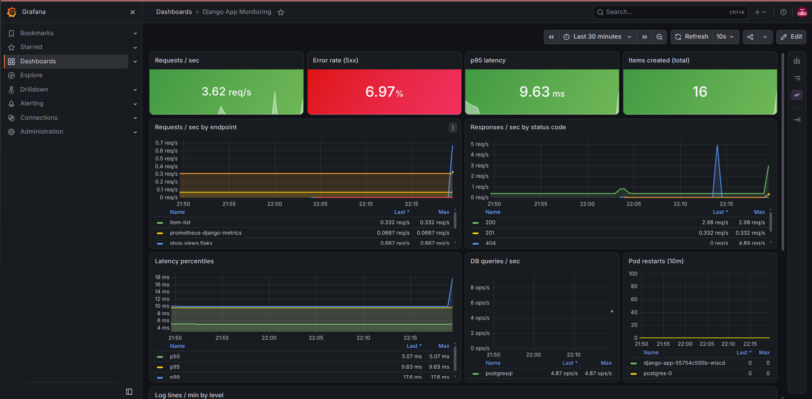
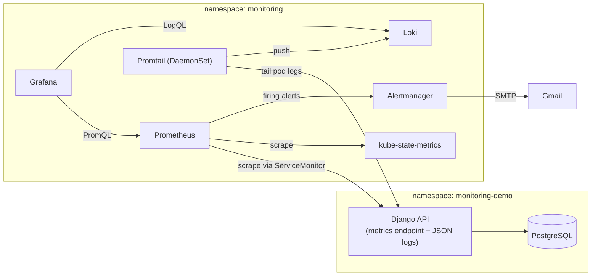
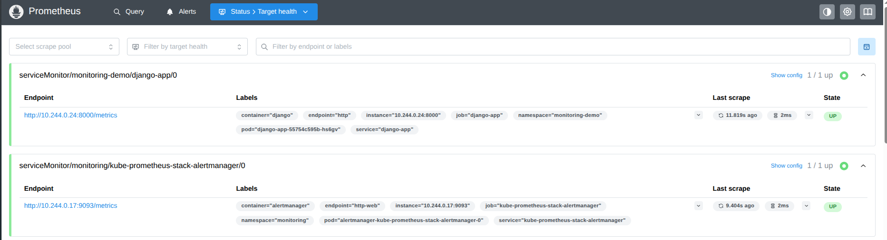
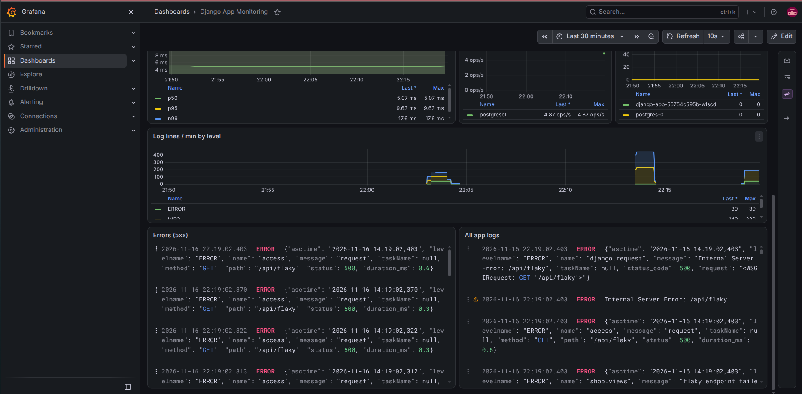
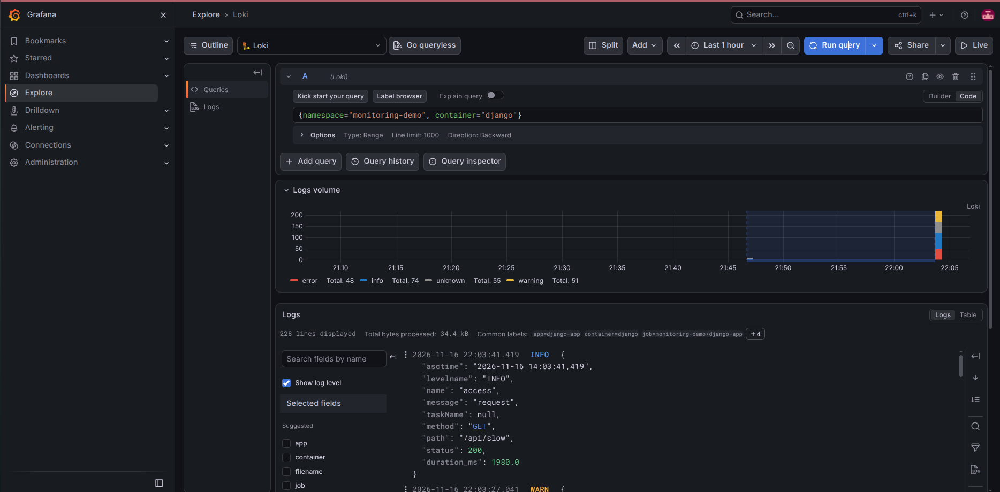
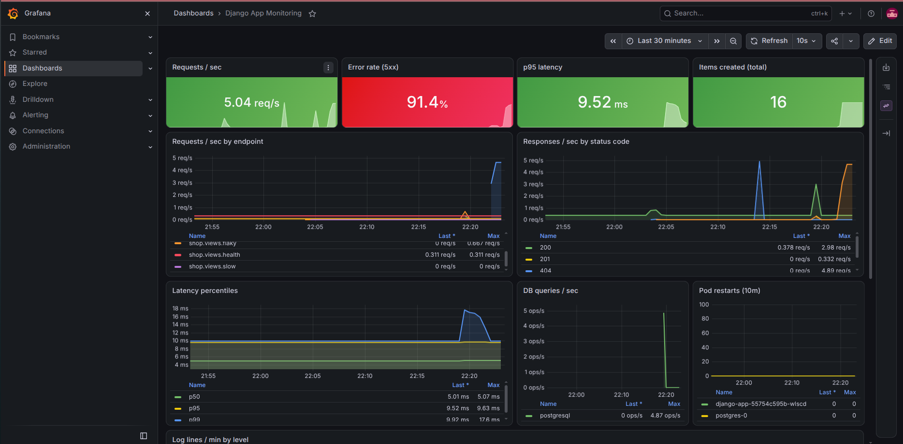
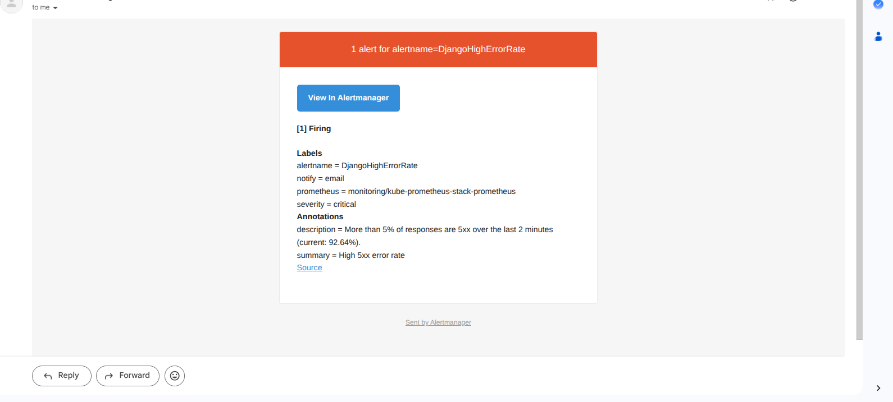
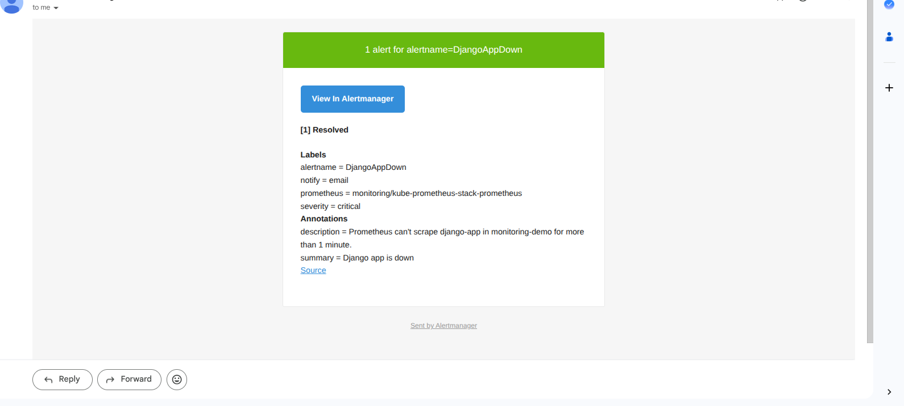

# Kubernetes Monitoring Stack: Prometheus, Grafana, Loki & Alertmanager

A hands-on observability project on Kubernetes. A deliberately small Django REST API (plus PostgreSQL) is the workload; the focus of the project is everything **around** it: metrics, logs, dashboards and email alerting.

- **Metrics**: Prometheus scrapes the app through a `ServiceMonitor`
- **Logs**: Promtail ships structured JSON logs to Loki
- **Dashboards**: Grafana, with an app dashboard provisioned as code
- **Alerting**: Prometheus rules → Alertmanager → Gmail (firing and resolved notifications)



## Architecture



**Design choice:** the application is deployed with plain Kubernetes manifests (small, and worth understanding line by line), while the third-party monitoring stack is installed with Helm (dozens of resources and CRDs that nobody should hand-write). Only the `values.yaml` files and rules live in this repo.

## Tech stack

| Area | Tools |
|---|---|
| App | Python, Django, Django REST Framework, Gunicorn, `django-prometheus`, `python-json-logger` |
| Database | PostgreSQL 16 (StatefulSet with a PVC) |
| Metrics & alerting | Prometheus Operator (`kube-prometheus-stack`), Alertmanager, kube-state-metrics, node-exporter |
| Logs | Loki (single binary, filesystem storage), Promtail |
| Visualization | Grafana (dashboard provisioned from a ConfigMap) |
| Platform | Kubernetes on minikube, Helm, Docker |

## Repository structure

```
.
├── config/                  # Django project settings
├── shop/                    # Demo app: API, custom metric, access-log middleware
├── Dockerfile
├── docker-compose.yml       # Local run (app + PostgreSQL)
├── .env.example             # Required environment variables (no secrets)
├── k8s-app/                 # Plain manifests: namespace, Postgres, Django, ServiceMonitor
├── monitoring/
│   ├── kube-prometheus-stack-values.yaml   # Resource-tuned values for a small cluster
│   ├── alertmanager-values.yaml            # Gmail SMTP + routing
│   ├── loki-values.yaml
│   ├── promtail-values.yaml
│   ├── loki-datasource-values.yaml         # Adds Loki as a Grafana datasource
│   ├── django-alerts.yaml                  # PrometheusRule
│   └── django-dashboard.yaml               # Grafana dashboard (ConfigMap)
└── docs/screenshots/
```

## What the app exposes

| Endpoint | Purpose |
|---|---|
| `GET /metrics` | Prometheus metrics (HTTP, latency, DB and a custom `shop_items_created_total`) |
| `GET/POST /api/items/` | CRUD against PostgreSQL |
| `GET /api/health` | Liveness/readiness probes |
| `GET /api/slow` | Random 0.5–3 s delay (latency alerts) |
| `GET /api/error` | Always returns 500 (error-rate alerts) |
| `GET /api/flaky?rate=0.3` | Fails randomly (realistic noisy traffic) |

Every request is logged to stdout as JSON (`method`, `path`, `status`, `duration_ms`), so Loki can filter on any of those fields.

## Getting started

### Prerequisites

Docker, `kubectl`, Helm 3 and minikube. Around 4 GB of RAM for the cluster.

### 1. Configuration

```bash
cp .env.example .env
# set SECRET_KEY and POSTGRES_PASSWORD
```

`.env` is the single source of truth: Docker Compose reads it, and the same file becomes the Kubernetes Secret. It is git-ignored and excluded from the image by `.dockerignore`.

### 2. Run locally (optional)

```bash
docker compose up --build
curl http://127.0.0.1:8000/api/health
```

### 3. Kubernetes deployment

```bash
# Cluster (a dedicated profile keeps it isolated from other projects)
minikube start -p monitoring --cpus=2 --memory=4096

# Build the image and make it available to the cluster
docker build -t monitoring-app:latest .
minikube -p monitoring image load monitoring-app:latest

# Application + database
kubectl apply -f k8s-app/namespace.yaml
kubectl create secret generic django-secrets --from-env-file=.env -n monitoring-demo
kubectl apply -f k8s-app/postgres-service.yaml -f k8s-app/postgres.yaml
kubectl apply -f k8s-app/django-service.yaml -f k8s-app/django.yaml
```

### 4. Monitoring stack

```bash
helm repo add prometheus-community https://prometheus-community.github.io/helm-charts
helm repo add grafana-community https://grafana-community.github.io/helm-charts
helm repo add grafana https://grafana.github.io/helm-charts
helm repo update

kubectl create namespace monitoring

# Gmail App Password (requires 2-Step Verification), stored only as a Secret
kubectl create secret generic alertmanager-gmail -n monitoring \
  --from-literal=password='<gmail-app-password>'

# Set your address in the file first (3 places)
sed -i 's/YOUR_EMAIL@gmail.com/you@gmail.com/g' monitoring/alertmanager-values.yaml

helm install kube-prometheus-stack prometheus-community/kube-prometheus-stack -n monitoring \
  -f monitoring/kube-prometheus-stack-values.yaml \
  -f monitoring/alertmanager-values.yaml \
  -f monitoring/loki-datasource-values.yaml \
  --timeout 15m

helm install loki grafana-community/loki -n monitoring -f monitoring/loki-values.yaml --timeout 15m
helm install promtail grafana/promtail -n monitoring -f monitoring/promtail-values.yaml
```

When the pods in `monitoring` are `Running`, connect the app and load the rules and the dashboard:

```bash
kubectl apply -f k8s-app/servicemonitor.yaml
kubectl apply -f monitoring/django-alerts.yaml
kubectl apply -f monitoring/django-dashboard.yaml
```

The `ServiceMonitor`, `PrometheusRule` and dashboard must be applied **after** the Helm install, because the CRDs and the Grafana sidecar come with the chart.

### 5. Access

```bash
kubectl port-forward --address 127.0.0.1 svc/django-app 8000:8000 -n monitoring-demo
kubectl port-forward --address 127.0.0.1 svc/kube-prometheus-stack-prometheus 9090:9090 -n monitoring
kubectl port-forward --address 127.0.0.1 svc/kube-prometheus-stack-grafana 3000:80 -n monitoring
kubectl port-forward --address 127.0.0.1 svc/kube-prometheus-stack-alertmanager 9093:9093 -n monitoring

# Grafana admin password
kubectl get secret kube-prometheus-stack-grafana -n monitoring \
  -o jsonpath="{.data.admin-password}" | base64 -d; echo
```

Use `127.0.0.1` rather than `localhost`: `kubectl port-forward` binds IPv4, and some browsers resolve `localhost` to IPv6 first.

Check `http://127.0.0.1:9090/targets`: the `django-app` target should be **UP**.




## Generate traffic

```bash
# normal traffic (note the trailing slash on /api/items/)
for i in $(seq 1 100); do curl -s http://127.0.0.1:8000/api/items/ > /dev/null; done
for i in $(seq 1 15);  do curl -s -X POST http://127.0.0.1:8000/api/items/ \
  -H "Content-Type: application/json" -d '{"name":"item","quantity":1}' > /dev/null; done

# noisy / failing traffic
for i in $(seq 1 60); do curl -s http://127.0.0.1:8000/api/flaky > /dev/null; done
```

## Dashboard

The *Django App Monitoring* dashboard is stored as a ConfigMap labelled `grafana_dashboard: "1"`, so Grafana's sidecar loads it automatically. No manual import.

| Row | Panels |
|---|---|
| Overview | Requests/sec, 5xx error rate, p95 latency, items created |
| Traffic | Requests/sec per endpoint, responses/sec per status code |
| Performance | p50/p95/p99 latency, DB queries/sec, pod restarts |
| Logs (Loki) | Log lines/min by level, 5xx errors, all application logs |



## Logs with Loki

Application logs are JSON, so LogQL can filter on parsed fields:

```logql
{namespace="monitoring-demo", container="django"} | json | status >= 500
{namespace="monitoring-demo", container="django"} | json | duration_ms > 1000
sum by (levelname) (count_over_time({namespace="monitoring-demo", container="django"} | json | __error__="" [1m]))
```



## Alerting

Rules live in `monitoring/django-alerts.yaml`:

| Alert | Condition | Severity |
|---|---|---|
| `DjangoAppDown` | No healthy `django-app` target for 1 min | critical |
| `DjangoHighErrorRate` | More than 5% of responses are 5xx for 2 min | critical |
| `DjangoHighLatencyP95` | p95 latency above 1 s for 2 min | warning |
| `DjangoPodRestarting` | More than 2 restarts in 10 min | warning |
| `PostgresNotReady` | PostgreSQL StatefulSet has no ready replica for 2 min | critical |

**Routing:** only alerts labelled `notify: email` are sent to Gmail. The many default alerts shipped with `kube-prometheus-stack` go to a `null` receiver, so the inbox is not flooded, but they stay visible in Alertmanager. `send_resolved: true` sends a second email when the problem clears.

### Demo: error-rate incident

```bash
for i in $(seq 1 1200); do curl -s http://127.0.0.1:8000/api/error > /dev/null; sleep 0.2; done
```

The error rate climbs on the dashboard, `DjangoHighErrorRate` goes *Pending* then *Firing*, and an email arrives.





### Demo: app down

```bash
kubectl scale deploy django-app -n monitoring-demo --replicas=0   # DjangoAppDown fires
kubectl scale deploy django-app -n monitoring-demo --replicas=1   # resolved email
```





## Lessons learned and design notes

- **Gunicorn runs one worker with threads.** `prometheus_client` keeps metrics per process, so several workers would give inconsistent numbers unless multiprocess mode is configured.
- **Resource tuning matters on a laptop.** Prometheus, Grafana and Alertmanager have explicit requests/limits, the disabled `kubeEtcd`/`kubeScheduler`/`kubeControllerManager`/`kubeProxy` monitors (always *down* on minikube) remove false alerts, and Loki's gateway and caches are turned off.
- **Secrets stay out of Git.** `.env` is ignored, the Gmail App Password only exists as a Kubernetes Secret mounted into Alertmanager (`smtp_auth_password_file`), and values files only hold placeholders.
- **Helm merges values files**, so each concern (resources, Alertmanager, datasource) lives in its own file. Always pass **all** of them on every `helm upgrade`.
- **Alertmanager config gotchas:** `null` must be quoted (`"null"`) when used as a receiver name, and matchers are strings (`'notify = "email"'`), not maps. The Prometheus Operator reports config errors in `kubectl describe alertmanager`.
- **Loki metric queries** fail on non-JSON lines unless you add `| __error__=""` after `| json`.
- **Promtail** has reached end-of-life upstream (Grafana Alloy is the successor). It is used here because it is simple and still works.

## Troubleshooting

| Symptom | Likely cause |
|---|---|
| `ErrImageNeverPull` | The image is not inside the cluster: `minikube -p monitoring image load monitoring-app:latest` |
| Django pod in `CrashLoopBackOff` at first start | Database not ready yet; wait, or `kubectl rollout restart deploy django-app -n monitoring-demo` |
| API server timeouts, everything slow | Not enough RAM; use a dedicated minikube profile with 4 GB and close other workloads |
| No Alertmanager pod | Config error: `kubectl describe alertmanager -n monitoring` |
| No email | `kubectl logs alertmanager-kube-prometheus-stack-alertmanager-0 -n monitoring -c alertmanager`; check the App Password and the `alertmanager-gmail` Secret |
| Port-forward page refused | The port-forward died (for example after a Helm upgrade); start it again |

## Possible next steps

- `postgres-exporter` for connection and query metrics
- Replace Promtail with Grafana Alloy
- Deploy both layers with ArgoCD
- Provision the cluster on EKS with Terraform
- Route critical alerts to Slack or PagerDuty in addition to email
